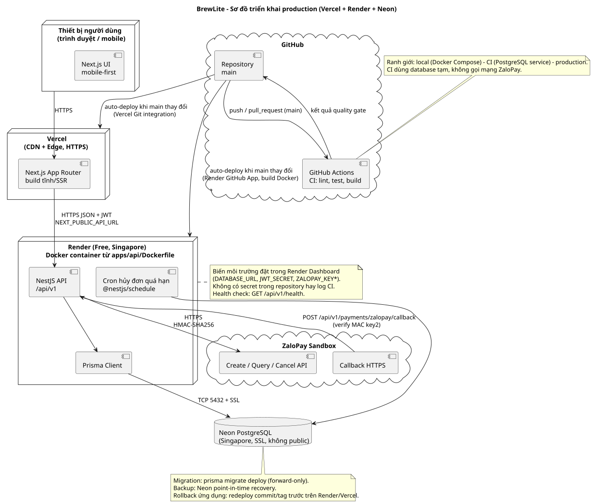

# Kiến trúc hệ thống BrewLite

## 1. Tổng quan kiến trúc

BrewLite là ứng dụng đặt hàng và thanh toán cà phê trực tuyến, được tổ chức theo mô hình **Monorepo**. Repository chứa hai ứng dụng độc lập: frontend tại `apps/web/` và backend tại `apps/api/`, cùng với tài liệu, kiểm thử và cấu hình triển khai.

Các công nghệ chính được sử dụng:

| Thành phần | Công nghệ |
|---|---|
| Frontend | Next.js 15, React 19, TypeScript, Tailwind CSS |
| Backend | NestJS 11, TypeScript, REST API |
| ORM | Prisma 6 |
| Database | PostgreSQL 16 |
| Payment Gateway | ZaloPay Sandbox |
| Containerization | Docker, Docker Compose |
| CI/CD | GitHub Actions, Vercel, Render |

Hệ thống triển khai frontend trên Vercel, backend dưới dạng Docker Web Service trên Render và cơ sở dữ liệu PostgreSQL trên Neon.

## 2. Kiến trúc phân lớp (Layered Architecture)

Backend được tổ chức theo các lớp xử lý, kết hợp với mô hình module của NestJS:

| Lớp | Thành phần | Trách nhiệm |
|---|---|---|
| Presentation | Next.js, React | Hiển thị giao diện và tiếp nhận thao tác người dùng. |
| API | NestJS Controller, DTO | Tiếp nhận HTTP request, kiểm tra và định tuyến yêu cầu. |
| Business Logic | NestJS Service | Xử lý nghiệp vụ của từng module. |
| Data Access | PrismaService | Thực hiện truy vấn và thao tác dữ liệu thông qua Prisma ORM. |
| Database | PostgreSQL | Lưu trữ dữ liệu nghiệp vụ của hệ thống. |

Frontend giao tiếp với backend thông qua REST API, sử dụng JSON và JWT cho các yêu cầu cần xác thực.

Tại backend, các request đi qua Global Validation Pipe để kiểm tra dữ liệu đầu vào, các Controller tiếp nhận yêu cầu và Service xử lý nghiệp vụ. PrismaService cung cấp khả năng truy cập PostgreSQL. TransformInterceptor chuẩn hóa response thành công và AllExceptionsFilter xử lý response lỗi.

## 3. C4 Container – Các thành phần hệ thống

Hình dưới đây mô tả kiến trúc triển khai thực tế của
BrewLite, bao gồm frontend, backend, cơ sở dữ liệu,
cổng thanh toán và quy trình CI/CD.



*Hình 1. Sơ đồ kiến trúc triển khai production của BrewLite.*

**Mô tả giao tiếp:**

- **Web:** cung cấp giao diện đặt hàng, quản lý giỏ hàng, tài khoản và theo dõi đơn hàng.
- **API:** tiếp nhận request từ Web, xác thực người dùng, xử lý nghiệp vụ và điều phối truy cập dữ liệu.
- **Database:** lưu trữ thông tin người dùng, sản phẩm, đơn hàng, thanh toán, nguyên liệu và các dữ liệu liên quan.
- **Payment:** ZaloPay Sandbox tiếp nhận yêu cầu tạo giao dịch, truy vấn, hủy giao dịch và gửi callback về API.

Sơ đồ triển khai production chi tiết được lưu tại `docs/architecture/deployment-diagram.puml`.

## 4. Các module nghiệp vụ

Backend được chia thành 9 module, được đăng ký trong `apps/api/src/app.module.ts`.

| STT | Module | Trách nhiệm |
|---:|---|---|
| 1 | AuthModule | Đăng ký, đăng nhập, xác thực JWT và đổi mật khẩu. |
| 2 | ProductsModule | Quản lý sản phẩm, danh mục và giá theo kích thước. |
| 3 | OrdersModule | Tạo đơn hàng, quản lý trạng thái và lịch sử đơn hàng. |
| 4 | PaymentsModule | Tích hợp ZaloPay Sandbox và quản lý giao dịch thanh toán. |
| 5 | CartModule | Quản lý giỏ hàng và các sản phẩm trong giỏ. |
| 6 | IngredientsModule | Quản lý nguyên liệu và thông tin tồn kho. |
| 7 | UsersModule | Quản lý thông tin người dùng. |
| 8 | RecipesModule | Quản lý công thức và định lượng nguyên liệu. |
| 9 | StockImportsModule | Quản lý phiếu nhập kho và chi tiết nguyên liệu nhập. |

Mỗi module được tổ chức với các thành phần Controller, Service, DTO và Module tùy theo chức năng, giúp phân tách trách nhiệm và thuận tiện cho việc bảo trì.

## 5. Database và Migration

BrewLite sử dụng PostgreSQL với Prisma ORM. Cấu trúc dữ liệu được khai báo trong `apps/api/prisma/schema.prisma`, trong khi các migration được lưu tại `apps/api/prisma/migrations/`.

Repository hiện có migration khởi tạo `20261114_init/migration.sql`.

Quy trình quản lý cơ sở dữ liệu:

1. Khai báo hoặc điều chỉnh model trong `schema.prisma`.
2. Tạo migration trong quá trình phát triển bằng Prisma Migrate.
3. Kiểm tra migration và cập nhật mã nguồn cùng repository.
4. Khi triển khai, sử dụng `prisma migrate deploy` để áp dụng các migration đã được ghi nhận.

Trong môi trường Docker, lệnh `prisma migrate deploy` được thực hiện khi container backend khởi động, trước khi chạy ứng dụng NestJS.

## 6. Logging, Health Check và Configuration

### 6.1. Logging và xử lý lỗi

Backend sử dụng cơ chế logging mặc định của NestJS và ghi thông tin khi ứng dụng khởi động.

`AllExceptionsFilter` xử lý ngoại lệ và chuẩn hóa response lỗi, bao gồm HTTP status code, error, message, timestamp và request path. `TransformInterceptor` chuẩn hóa response thành công.

Repository chưa triển khai hệ thống logging tập trung riêng.

### 6.2. Health Check

Endpoint kiểm tra trạng thái API:

`GET /api/v1/health`

Kết quả trả về khi API hoạt động:

```json
{
  "status": "ok",
  "service": "brewlite-api"
}
```

Endpoint này là liveness probe, xác nhận API đang phản hồi nhưng không thực hiện truy vấn kiểm tra kết nối database.

### 6.3. Configuration

Backend sử dụng `ConfigModule.forRoot({ isGlobal: true })` để quản lý cấu hình thông qua biến môi trường.

Các biến quan trọng:

| Biến | Mục đích |
|---|---|
| `DATABASE_URL` | Chuỗi kết nối PostgreSQL. |
| `JWT_SECRET` | Khóa ký JWT. |
| `JWT_EXPIRATION` | Thời hạn token. |
| `PORT` | Cổng chạy backend. |
| `FRONTEND_URL` | Cấu hình CORS cho frontend. |
| `ZALOPAY_SANDBOX_ENABLED` | Bật hoặc tắt ZaloPay Sandbox. |
| `ZALOPAY_APP_ID` | App ID của ZaloPay Sandbox. |
| `ZALOPAY_KEY1`, `ZALOPAY_KEY2` | Khóa ký request và xác thực callback. |

File `.env.example` cung cấp cấu trúc biến môi trường mẫu. Các giá trị bí mật được cấu hình trong môi trường triển khai thay vì commit trực tiếp vào repository.

## 7. Trade-off và quyết định kiến trúc

### 7.1. Lựa chọn Monorepo

Theo ADR-001, nhóm lựa chọn Monorepo để quản lý frontend, backend, tài liệu và kiểm thử trong một repository.

- **Ưu điểm:** dễ đồng bộ thay đổi giữa frontend và backend, thuận tiện review Pull Request và quản lý tài liệu.
- **Hạn chế:** CI phải cài đặt và build riêng cho từng ứng dụng; API contract cần được đồng bộ thủ công.

Nhóm không sử dụng Nx hoặc Turborepo nhằm giữ cấu hình đơn giản, phù hợp quy mô dự án.

### 7.2. Lựa chọn ZaloPay Sandbox

Theo ADR-002, nhóm quyết định sử dụng ZaloPay Sandbox làm cổng thanh toán duy nhất, thay thế luồng Mock Payment trước đó.

- **Ưu điểm:** kiểm chứng được quy trình tạo giao dịch, callback, chữ ký HMAC và đồng bộ trạng thái thanh toán.
- **Hạn chế:** cần cấu hình tài khoản và khóa sandbox; CI không thực hiện giao dịch mạng trực tiếp với ZaloPay mà kiểm thử logic thông qua service/gateway giả.

### 7.3. Lựa chọn nền tảng triển khai

Nhóm sử dụng Vercel cho frontend, Render cho backend và Neon cho PostgreSQL.

- **Ưu điểm:** tách biệt các thành phần triển khai, hỗ trợ HTTPS và thuận tiện cung cấp môi trường demo công khai.
- **Hạn chế:** phụ thuộc vào dịch vụ bên thứ ba, giới hạn tài nguyên của gói miễn phí và có thể phát sinh độ trễ khi dịch vụ khởi động lại.

## 8. Tài liệu liên quan

- [README dự án](../README.md)
- [SRS](../requirements/srs.md)
- [ADR-001: Monorepo](adr/001-monorepo.md)
- [ADR-002: ZaloPay Sandbox](adr/002-payment-zalopay-sandbox.md)
- [Deployment Diagram](deployment-diagram.puml)
- [Hướng dẫn triển khai](../deployment.md)
- [Traceability Matrix](../traceability-matrix.md)
